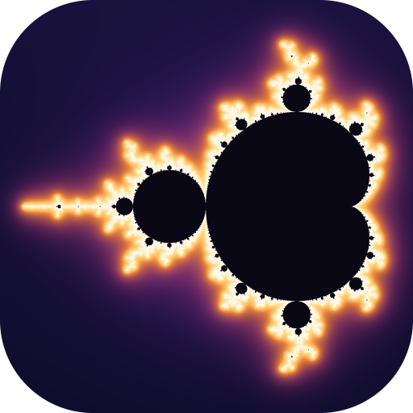
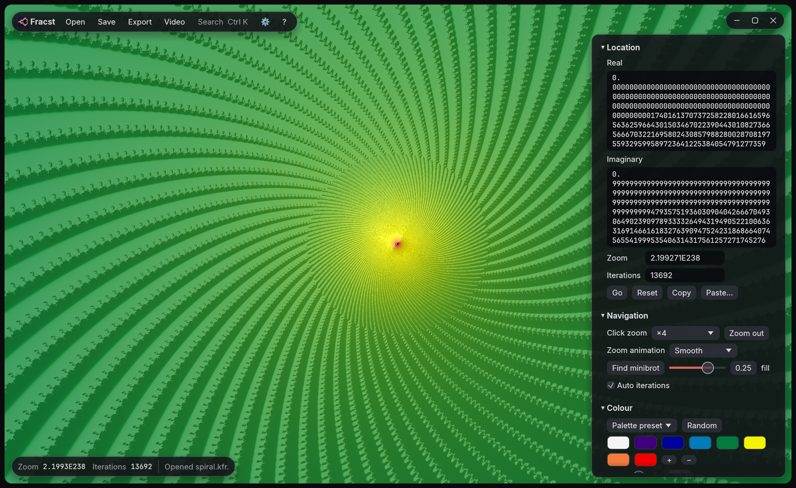

# fracst

A fast deep-zoom Mandelbrot set explorer written in modern Rust: a faster
alternative to [Kalles Fraktaler 2](https://mathr.co.uk/kf/kf.html) (KF2).

- Zoom to 10^1000 and beyond, interactively.
- Opens and saves KF2 `.kfr` locations, and embeds the location in saved PNGs
  the same way KF2 does. KF2 and fracst can open each other's images.
- KF2-style colouring: 1024-entry palettes interpolated from key colours,
  `IterDiv`, `ColorOffset`, transfer functions, and neighbour-difference slope shading.
- Newton's method minibrot finder ("jump to the nearest minibrot").
- CLI for batch renders, supersampling and KF2-style zoom-out sequences for videos.



## Download

Prebuilt 64-bit packages for **Windows**, **macOS** (universal: Apple Silicon and Intel)
and **Linux** are on the [Releases page](https://github.com/alexcrisan1611/fracst/releases/latest).
Each contains the explorer (`fracst`) and the command-line renderer (`fracst-cli`).
The builds are not code-signed. On Windows choose **More info → Run anyway** if
SmartScreen asks. On macOS right-click the app and choose **Open** the first time.

To build from source instead, install [Rust](https://rustup.rs) and run
`cargo run --release -p fracst`.

## Why it is faster

KF2 renders with perturbation plus *series approximation*, detects glitched
pixels and fixes them with extra reference orbits, and falls back to slow
number types past 1e300 zoom. fracst uses newer techniques:

| | KF2 | fracst |
|---|---|---|
| Skipping iterations | Series approximation (start of the orbit only) | **Bilinear approximation** (BLA): skips anywhere along the orbit, in steps of up to 2^k iterations |
| Glitches | Detect, add references, re-render | **Rebasing**: one reference orbit, no glitches by construction |
| Reference length | Always up to the iteration limit | **Stops after one period** when the centre is on a minibrot nucleus |
| Interior pixels | Iterated to the limit | **Interior detection** stops once a pixel is attracted to a cycle |
| Past 1e300 | `long double` / `floatexp` for the whole pixel | Extended range (shared-exponent complex) **only while the offset is tiny**, then plain `f64` |
| Reference orbit | MPFR | Custom fixed-point bignum (squarings only, truncated products) |

BLA and rebasing were introduced by Zhuoran on fractalforums. The theory is
written up by Claude Heiland-Allen in [deep zoom theory and practice](https://mathr.co.uk/web/deep-zoom.html)
and used in his [Fraktaler 3](https://fraktaler.mathr.co.uk/). fracst
implements these published algorithms independently and contains no code from
KF2 or Fraktaler 3.

## Benchmarks

1920×1080, AMD Ryzen 7 8845HS (8 cores / 16 threads), `cargo run --release
-p fracst-core --example bench -- --baseline`. Times are the first render
including the reference orbit, and vary by about ±30% between runs on this
laptop (boost clocks and thermals).

| Location | Zoom | Avg iterations | fracst | Plain perturbation | Speedup |
|---|---|---:|---:|---:|---:|
| Overview | 1 | 11 | 0.02 s | 0.05 s | 2× |
| Seahorse minibrot | 3e8 | 2,929 | 2.6 s | 3.4 s | ~1× |
| Spiral | 2e238 | 2,186 | 0.13 s | 2.2 s | 17× |
| Spiral | 8e397 | 4,024 | 0.25 s | 19.4 s | 76× |
| Spiral | 1e998 | 11,769 | 0.35 s | 57.8 s | 165× |
| Inside a minibrot (21% interior, 1M max iterations) | 2e400 | 136,874 | 6.0 s | not run | — |

"Plain perturbation" is the same engine with BLA and interior detection
turned off: one reference with rebasing, so it needs no glitch passes.
It is a stand-in, not KF2 itself. KF2's series approximation skips the start
of exterior orbits, so expect smaller gains than these on simple exterior
views. KF2 iterates interior pixels to the limit and re-renders glitches, so
expect larger gains around minibrots. At shallow zooms such as the seahorse
row, BLA cannot skip anything and fracst runs at plain perturbation speed.

For a head-to-head test, `--export` writes every benchmark location to
`bench-locations/*.kfr`, which you can open in KF2 and time.

## Accuracy

`cargo test --release` renders test views at zooms from 1e6 to about 1e400:
shallow and deep minibrots, spirals, and a reference sitting exactly on a nucleus.
It compares sampled pixels against brute-force fixed-point iteration of
the same points at higher precision. The renders must agree on the escape
iteration, and interior detection may not flag any pixel that escapes. All
of these run with and without BLA.

The BLA tolerance defaults to ε = 2^-40. Fraktaler 3 hard-codes 2^-24, but
in the tests it misplaced more than 1% of pixels near a minibrot. The
tighter tolerance costs only a few percent more steps. You can change it in
the GUI (Rendering → BLA precision bits) or with `--bla-bits`.

## Usage

### Explorer (`fracst`)

```
cargo run --release -p fracst [location.kfr | image.png]
```

| Action | Effect |
|---|---|
| Left click | Centre on the point and zoom in (×4 by default) |
| Right click | Zoom out |
| Mouse wheel | Zoom around the cursor |
| Drag | Pan |
| Esc | Cancel the current render |
| Ctrl+O / Ctrl+S / Ctrl+E | Open location, save `.kfr`, export PNG |
| Drop a file | Open a `.kfr` or PNG with an embedded location |

The side panel covers:

- **Location**: arbitrary-precision coordinates, plus KFR copy and paste.
- **Find minibrot**: Newton's method.
- **Auto iterations**.
- **Colouring**: palette presets, a random palette, editable key colours,
  `IterDiv`, offset, transfer function, slopes and interior colour.
- **Rendering**: resolution scale, BLA, interior detection, bailout and
  reference reuse.
- **Export**: any size with supersampling.
- **Statistics**: per-stage timings, BLA skip factor and iteration range.

While a frame renders, the previous one is shown stretched to the new view.
Slow frames get a quarter-resolution preview first.

### Command line (`fracst-cli`)

```
# Render a KF2 location (or a PNG saved by KF2/fracst) at 1080p with 2x2 supersampling
fracst-cli location.kfr -W 1920 -H 1080 --supersample 2 -o out.png

# Coordinates directly, any number of digits
fracst-cli --re -0.7436438870371587 --im 0.1318259042053120 --zoom 1e12 -i 50000 -o seahorse.png

# Jump to the nearest minibrot and frame it at 1/4 of the image height
fracst-cli location.kfr --find-minibrot --mini-zoom 0.25 --save-kfr -o mini.png

# KF2-style zoom-out sequence for videos (reuses the reference orbit throughout)
fracst-cli deep.kfr --zoom-out 500 --zoom-out-factor 2 -o frames/zoom.png
```

`fracst-cli --help` lists every option.

### Benchmarks

```
cargo run --release -p fracst-core --example bench [-- --baseline] [--export]
```

## KF2 compatibility

Read and written: `Re`, `Im`, `Zoom` (any exponent), `Iterations`, `IterDiv`,
`ColorOffset`, `ColorMethod` (0 linear, 1 sqrt, 2 cbrt, 3 log, 9 log-log, 11 fourth root),
`Colors` and `InteriorColor` (KF2's B,G,R order), `Smooth`, `Flat`, `Slopes`,
`SlopePower`, `SlopeRatio`, `SlopeAngle`, and `ImagPointsUp`. KF2's default
imaginary axis points down, and files without `ImagPointsUp: 1` render the
same way KF2 shows them.

Not supported yet:

- Formulas other than z² + c (`FractalType` ≠ 0, `Power` ≠ 2).
- Rotation and stretch.
- Distance-estimation colour methods.
- Multi-colour and texture options.

The icon is rendered by fracst itself:
`cargo run --release -p fracst-core --example icon` regenerates `assets/icon.*`.

## Project layout

```
crates/fracst-core   engine: fixed.rs (bignum), floatexp.rs + num.rs (extended range),
                     reference.rs, bla.rs, perturb.rs, render.rs, newton.rs,
                     colour.rs, kfr.rs, image.rs
crates/fracst-cli    command-line renderer
crates/fracst        egui explorer (render thread in worker.rs)
```

## Roadmap

- A rescaled-`f64` deep phase. Extended-range steps are still about 6× slower
  than `f64` steps, and they dominate inside deep minibrots.
- GPU rendering (wgpu compute).
- More formulas: Burning Ship, higher powers, hybrids.
- Distance-estimation colouring and EXR / KFB raw output.

## License

Licensed under either of [Apache License 2.0](LICENSE-APACHE) or [MIT](LICENSE-MIT), at your option.
